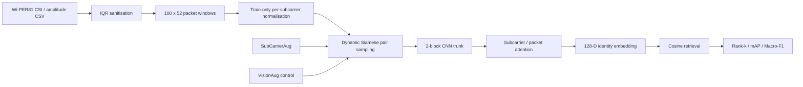

# WiFi-CSI ReID

**Physics-aware person re-identification from Wi-Fi Channel State Information (CSI).**

This project investigates a simple question: if Wi-Fi CSI carries person-specific structure, should it be trained like an image—or like a physically structured radio signal?

The pipeline learns identity embeddings directly from numeric CSI amplitude windows using Siamese metric learning, signal-aware augmentation, dynamic pair sampling, and frequency/time attention. A controlled ablation study shows that generic image transformations can be actively harmful when they disturb the physical meaning of the subcarrier axis.

## Results at a glance

| Result | Value |
| --- | ---: |
| Controlled baseline Rank-1 | **79.1%** |
| Reported full system Rank-1 | **90.3%** |
| Best observed Rank-1 (M4) | **90.7%** |
| Reported full system Rank-5 | **97.7%** |
| Reported full system mAP | **0.862** |
| VisionAug control Rank-1 | **56.4%** |
| SubCarrierAug matched-stage Rank-1 | **88.5%** |

The most important result is not just the final accuracy. Under a matched experimental stage, the image-style augmentation control fell to **56.4% Rank-1**, while the physics-grounded augmentation reached **88.5%**. The experiment therefore tests the representation assumption itself rather than simply adding more model capacity.

> **Scope:** these are closed-set Wi-PER81 results. Every evaluation identity is represented during training; this project does not claim open-set identification of previously unseen people.

## System design



## What changed from the baseline

The original baseline learned useful identity structure but overfit rapidly. Investigation showed that the pair dataset was generated only once before training, so the network repeatedly saw roughly the same finite set of pairs across all epochs.

The completed experiment series then introduced changes one at a time:

1. **Epoch-refreshed pair sampling** — redraws training pairs instead of memorizing one fixed pair set.
2. **VisionAug control** — deliberately applies image-style flip/crop/jitter to test whether photographic augmentation transfers safely to CSI.
3. **SubCarrierAug** — restricts augmentation to transformations with a direct RF/acquisition interpretation.
4. **Dual-axis attention** — learns both frequency/subcarrier importance and packet/time importance.
5. **Hard-negative mining** — included in the reported full stack; the completed ablation did not show an additional improvement over M4, so this is presented as a mixed result rather than a guaranteed gain.

## Physics-grounded augmentation

`SubCarrierAug` operates directly on the CSI amplitude matrix:

| Transform | Motivation |
| --- | --- |
| Gain jitter | AGC / transmit-power variation |
| Subcarrier dropout + interpolation | Narrowband interference |
| Temporal resampling | Packet-rate / clock variation |
| Amplitude noise | Thermal noise / CSI estimation error |
| Window re-cutting | Different packet offset from the same capture |

The experimental control uses operations such as horizontal flipping and resized cropping. Those are common for photographs but reverse or rescale the ordered subcarrier axis, changing the meaning of the measurement rather than creating another physically plausible observation.

## Ablation study

| Config | Description | Rank-1 | 95% CI | Rank-5 | mAP | Macro-F1 |
| --- | --- | ---: | --- | ---: | ---: | ---: |
| M0 | Controlled baseline | 0.791 | [0.742, 0.842] | 0.945 | 0.765 | 0.769 |
| M1 | + refreshed pairs | 0.883 | [0.844, 0.923] | 0.963 | 0.843 | 0.867 |
| M2 | + VisionAug control | 0.564 | [0.505, 0.626] | 0.802 | 0.514 | 0.536 |
| M3 | + SubCarrierAug | 0.885 | [0.845, 0.926] | 0.977 | 0.857 | 0.878 |
| M4 | + dual-axis attention | **0.907** | [0.870, 0.942] | **0.977** | **0.863** | **0.901** |
| M5 | + hard negatives (reported full system) | 0.903 | [0.866, 0.938] | **0.977** | 0.862 | 0.895 |

Results are means across **3 random seeds**. Bootstrap confidence intervals are over held-out probes.

The full numeric table is available at [`results/ablation.csv`](results/ablation.csv).

## Repository structure

```text
wifi-csi-reid/
├── docs/                   # dataset notes and result summaries
├── results/                # reported metrics in machine-readable form
├── scripts/                # smoke test / runnable utilities
├── src/wifi_reid/          # modular reference implementation
├── tests/                  # synthetic unit tests
├── pyproject.toml
├── requirements.txt
└── README.md
```

## Setup

```bash
python -m venv .venv
source .venv/bin/activate       # Windows: .venv\Scripts\activate
pip install -e ".[dev]"
```

Run the synthetic checks without downloading the dataset:

```bash
python scripts/smoke_test.py
pytest -q
```

Train a reference model once Wi-PER81 is available locally:

```bash
python scripts/train.py \
  --raw-dir /path/to/Wi-PER81 \
  --aug subcarrier \
  --dual-axis \
  --output checkpoints/subcarrier_dual.pt
```

Evaluate the saved checkpoint on the held-out session-B probe/gallery split:

```bash
python scripts/evaluate.py \
  --raw-dir /path/to/Wi-PER81 \
  --checkpoint checkpoints/subcarrier_dual.pt
```

## Dataset

The dataset is intentionally not committed to this repository. See [`docs/dataset.md`](docs/dataset.md) for the source and citation.

Expected capture geometry used by the code:

```text
1000 packets x 52 data subcarriers per capture
100-packet windows
10 windows per acquisition session
```

The completed evaluation uses session A for model development/training and held-out session B windows for closed-set retrieval evaluation.

## About the code in this repository

The modular `src/` package reorganizes the project implementation into reusable components. The completed numerical results are preserved from the experiment reports under `docs/` and `results/`.

## Limitations

- Closed-set protocol: results do not establish generalization to identities never seen during training.
- One dataset / acquisition setup: robustness across hardware, rooms, placements, or longer time gaps is not established.
- Hard-negative mining did not improve the completed M4 result under the reported configuration.
- The modular code is a cleaned reference implementation reconstructed from the available experiment materials; the exact historical training environment/checkpoints are not bundled.

## Reference

This project uses the **Wi-PER81** dataset introduced by Cascio *et al.*:

> Cascio, M., Cinque, L., Distante, D., Foresti, G. L., & Fagioli, A. *A Benchmark Dataset for Radio Signal Image-based Person Re-Identification*. Scientific Data 12, 1522 (2025). https://doi.org/10.1038/s41597-025-05804-0

Dataset: https://doi.org/10.6084/m9.figshare.26984497

---

<sub>Development note: the original experimentation phase was carried out collaboratively with additional team members.</sub>
